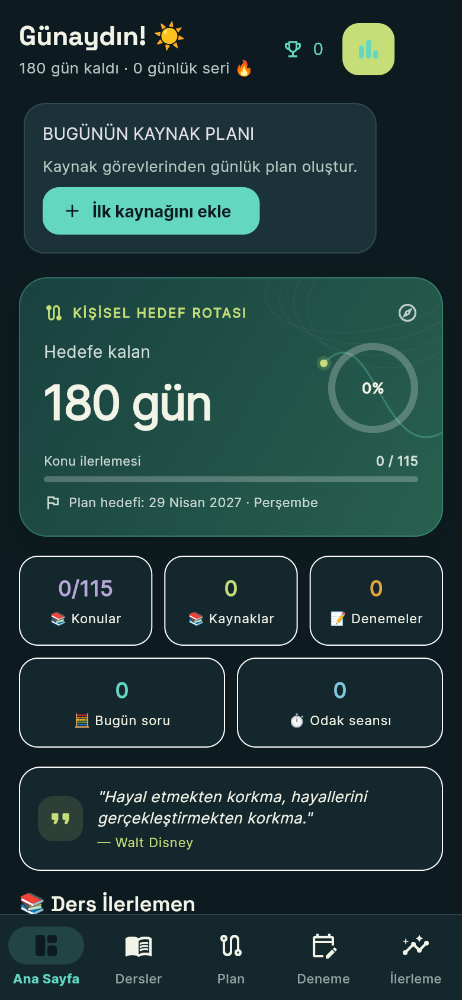
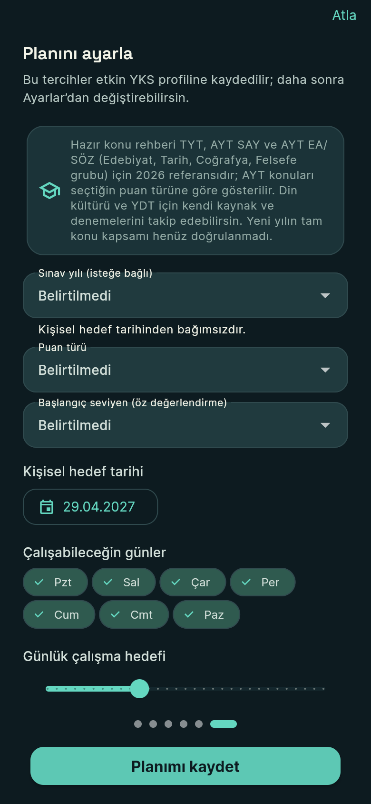
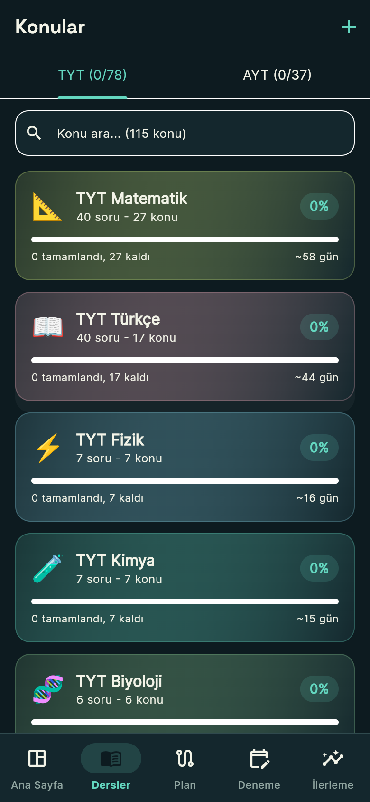
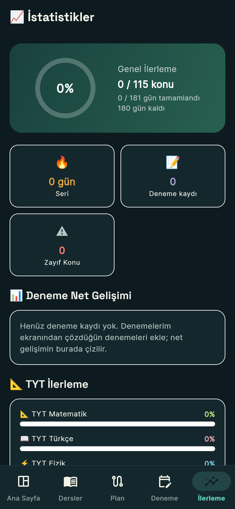

# Sınav Rotası

**Canlı demo:** [sevketsekerciler63.github.io/sinav-rotasi](https://sevketsekerciler63.github.io/sinav-rotasi/). Web sürümü; veriler kendi tarayıcında kalır.

YKS adaylarının hedef, ders ve konu ilerlemesi, deneme sonuçları ve çalışma düzenini yerel olarak takip etmesi için Flutter uygulaması.

## Kısaca

- Hesap, sunucu ve analitik yok. Veriler telefonda kalır; JSON olarak yedeklenip geri yüklenebilir.
- Flutter (Dart). Android, iOS ve web için hazırlandı; iOS derlemesi denenmedi.
- Her değişiklikte biçim, analiz, testler ve web derlemesi çalışıyor (GitHub Actions). Son kayıtta 102 test geçiyordu.
- Mağazada yayımlanmadı. Gerçek telefonda kabul testi, ekran okuyucu ve düşük donanım denemeleri yapılmadı.

  
  

  
  

Ekran görüntüleri web derlemesinden (390 px genişlik) alınmıştır; yeni kurulumdaki boş durumu gösterir.

## Nasıl geliştirdim

Bu uygulamayı yapay zekâ asistanlarıyla birlikte yazdım. Neyin yapılacağına ben karar verdim (örneğin kendi soru üretimi ve puan tahmini olmayacak), kodun çoğunu asistan yazdı. Her değişiklikten sonra testler, analiz ve derleme çalıştırıldı. Çalıştırılamayan ya da telefonda denenmeyen şeyler aşağıdaki "Bilinen durum" bölümünde yazıyor. `docs/` klasöründe asistanla yaptığımız denetim ve ilerleme notları duruyor.

## Mevcut kapsam

- TYT/AYT ders ve konu takibi; profile özel ders ve konu ekleme
- Kaynakları otomatik görevlere bölme; görevleri kaynağın dersindeki hazır veya kişisel konulara bağlama. Bağlantılar yerel kayıtta ve JSON yedeğinde korunur; kaynak ilerlemesi konu tamamlanmasını kendiliğinden değiştirmez.
- Denemelerim kayıtlarından kronolojik net grafiği; TYT, AYT alanları ve YDT dilleri ayrı karşılaştırılır. Netler ve tarih seçici Türkçe gösterilir.
- YKS profilinde SAY/EA/SÖZ/DİL puan türü ve kullanıcının Başlangıç/Temel/Orta/İleri öz değerlendirmesi; JSON yedeğinde saklanır, eski profiller “Belirtilmedi” olur
- Haftalık uygun gün ve süre hedefiyle bugünden sınava kadar oluşturulan plan; 95 temel görev, dinlenme günleri ve zayıf konulara göre tekrar dönemi
- Hedefler, zayıf konular, istatistik, rozet ve Pomodoro
- Bilgi kartı ve zayıf konularda yerel aralıklı tekrar; tamamlanan günlük tekrar görevi bağlı zayıf konunun tarihini ilerletir
- Android/iOS'ta varsayılanı kapalı, kullanıcı izniyle açılan günlük yerel hatırlatıcı; cihaz saatini kullanır ve cihaz dışına/yedeğe eklenmez
- Profil bazlı yerel saklama ve JSON yedekleme/geri yükleme
- Yerel profil yazmaları sıraya alınır; yarıda kesilmiş çok anahtarlı güncelleme açılışta önceki değerlere döndürülür
- Hedeflerde pozitif sayı ve gerçek bitiş tarihi; tamamlanma mevcut ilerlemeden hesaplanır
- Denemelerde planlanan tarih, gerçekleşme tarihi ve son düzenleme zamanı ayrı tutulur
- Soru artışları olay tarihiyle, odak seansları tamamlandı/atlandı/iptal edildi durumu ve süreyle ayrı saklanır; etkin Pomodoro profilde saklanıp yeniden açılışta sürdürülür
- Şablon dışındaki korunmuş eski günlük faaliyetler haftalık raporda ayrı arşiv bölümünde görünür; güncel hafta toplamına eklenmez
- Yerel kayıtlar yüklenmeden çalışma ekranı açılmaz; yükleme ve kayıt hataları kullanıcıya gösterilir
- Deneme netlerini profil derslerine göre toplama; −soru/4 ile soru sayısı arasında 0,25 adımlı giriş; resmî puan ve sıralama tahmini gösterilmez
- Rota Atlası görsel kimliği, açık/koyu görünüm ve web ön izlemesi
- Aynı rota-hedef simgesi web/PWA, Android launcher ve iOS App Store ikon boyutlarında kullanılır; düzenlenebilir kaynak `web/icons/sinar-rotasi.svg` dosyasıdır
- Android release imzası `android/key.properties` ile yapılandırılır; anahtar yokken release derlemesi durur, yerel debug imzalama ayrıca açıkça etkinleştirilmelidir

## Çalıştırma

Flutter SDK ile proje kökünde `flutter pub get`, ardından `flutter run` kullanın.

## Bilinen durum

- Veri `SharedPreferences` içinde saklanır. Profil saklama şeması sürüm 14'tür (`ProfileStorage.schemaVersion`); daha eski yedekler geriye uyumlu okunur. Eski kayıtların ilk gerçek cihaz açılışında taşındığı henüz doğrulanmadı.
- 95 temel plan görevi `day_001`–`day_095` kimlikleriyle saklanır. Uygun çalışma günleri değişince tarihler yeniden düzenlenir; görev ilerlemesi kimliğini korur. Daha fazla uygun gün varsa ek günlere tekrar/deneme analizi gelir; daha az gün varsa temel görevler bazı günlerde birlikte gösterilir.
- Tamamlanmamış görev, uygulama yeni günde açıldığında veya öne geldiğinde sıradaki uygun çalışma gününe taşınır; tamamlanan görevler yeniden planlanmaz.
- Günlük dakika tercihi hedef olarak gösterilir; mevcut görevlerin gerçek süre tahmini bu tercihe göre henüz yeniden hesaplanmıyor. Temel görevleri bir güne sığdırmak için birleştirme gerekebilir.
- Yeni kurulumun kişisel plan hedefi kurulum anından 180 gün sonrasına ayarlanır; kayıtlı profiller otomatik değişmez. Bu tarih resmî sınav tarihi değildir. Kullanıcı Ayarlar'dan kendi hedefini güncelleyebilir; resmî tarih açıklanmadan YKS tarihi uydurulmamalıdır.
- Hazır konu kataloğu 167 konudur: TYT + AYT SAY 115 konu; 2026-10-30'da MEB OGM içindekiler ve kavram öğretimi çalışma listelerine göre AYT Edebiyat, Tarih-1, Coğrafya-1, Tarih-2, Coğrafya-2 ve Felsefe grubu için 52 konu eklendi. AYT dersleri profilin puan türüne göre gösterilir (belirtilmemiş profil SAY kataloğunu görür); çalışılmış bir ders puan türü değişince gizlenmez. Din kültürü için hazır konu yoktur; mağaza gizlilik politikası taslağı docs/privacy-policy.md içindedir; KPSS şablonu ve ekranları henüz yoktur.
- Puan türü ve öz değerlendirme profil bilgisidir; günlük görevler ve süreler bu seçime göre henüz kişiselleştirilmez. Müfredat/puan türü kapsam eşlemesi ayrıca doğrulanmalıdır.
- Yedek panoya kopyalanabilir veya JSON dosyası olarak kaydedilebilir; içe aktarmada dosya seçme, panodan yapıştırma ve metin alanı desteklenir. Önizleme ve etki onayı korunur; yükleme sonrası kısa süreli geri alma sunulur.
- Eski toplam soru sayısı korunur fakat tarih bilgisi olmadığı için günlük/haftalık soru raporuna katılmaz; tarih anahtarı korunmuş eski plan kayıtları raporda ayrı gösterilir.
- Okunamayan üst düzey günlük plan kayıtları ayrı karantinada ham haliyle korunur, geçerli boş plan yüklenir ve ham kayıt JSON yedeğine dahil edilir. Karantina kaydı Ayarlar'da gösterilir.
- Profil geçişi, çok anahtarlı yazma ve Pomodoro devamı için kaynak korumaları eklendi. Net girişleri negatif/çeyrek değerleri koruyup soru sınırlarını doğrular; kaydedilmemiş Pomodoro sonucu kararlı kimlik ve bitiş bilgisiyle yeniden denenir. Analyzer ve web release derlemesi temiz. Davranış/regresyon testleri, işlem kesintisi enjeksiyonu, yedek round-trip ve gerçek cihazdaki zorla kapatıp açma doğrulaması bekliyor.
- Günlük plan kartındaki soru sayısı yalnız seçilen günün tarihli soru olaylarından hesaplanır; tarihi belirsiz eski toplamlar haftalık raporda ayrıca belirtilir. Haftalık ayrıntı, mevcut şablondan çıkmış eski tamamlanma tarihlerini de gösterebilir.
- Kart ve zayıf konu tekrarları cihaz içinde tarihlendirilir; günlük hatırlatıcı bunlardan ayrı, isteğe bağlı bir cihaz bildirimidir. Profil/hedef tarihi değişince planlı bildirim güncellenir. Eski tamamlanmış günlük tekrarların konu bağlantısı bulunmayabilir, yeni bağlı görevler bu tarihe göre planlanır.
- Son başarılı dışa aktarma zamanı cihazda gösterilir ve profil yedeğine dahil edilmez. Gerçek Android/iOS dosya seçici, farklı cihaz/origin taşıması ve geri yükleme round-trip kabulü bekliyor.
- Ayarlarındaki “Veri ve gizlilik” özeti yerel veri alanını, kullanıcı seçtiğinde açılan YouTube ve kart kaynak bağlantılarını, yedek kapsamını, cihazdaki hatırlatıcı tercihini ve silme etkisini açıklar. Inter ve Space Grotesk lisanslarıyla uygulamaya gömülüdür; fontlar için çalışma anında ağ isteği yapılmaz.
- `flutter test` ile katalog, depolama/kurtarma, günlük soru tarihleri, net trendi, Türkçe tarih seçici ve kaynak görev/konu bağlantısı kontrolleri çalıştırılır. Konu bağlantısında kayıt hatası sonrası taslak, yeniden açma ve JSON yedek gidiş-dönüşü sınanır.
- Android uygulama kimliği mevcut cihaz verisini korumak için `com.yks.yks_study_app` olarak bırakılmıştır.
- [Release checklist](docs/release-checklist.md) sürüm, Android imzası, build, güncelleme ve geri dönüş akışını açıklar. Üretim keystore'u yoktur; yerel debug imzalı release için `ALLOW_DEBUG_SIGNING_FOR_RELEASE=true` açıkça ayarlanmalıdır. iOS artefaktı macOS/Xcode üzerinde derlenip doğrulanmalıdır.
